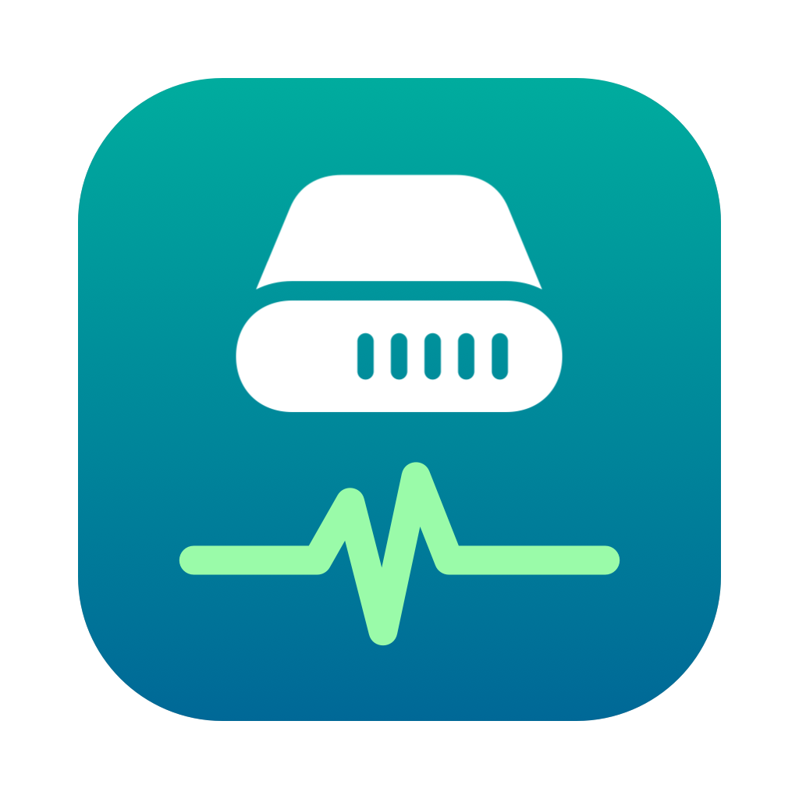

<p align="center"></p>

# DiskHealth

A small macOS menu bar app that keeps an eye on the health of your SSDs and HDDs —
in the spirit of SSD Reporter. It reads S.M.A.R.T. data through a bundled
[`smartctl`](https://www.smartmontools.org/), shows wear, temperature, data written and error counters
with history charts, and sends a macOS notification when a drive starts to degrade.

> Available in English and Ukrainian (follows the macOS language). Опис українською — [нижче](#українською).

## Features

- Every physical drive `smartctl` can see: internal NVMe/SATA, external Thunderbolt, and USB drives whose bridge passes SMART through.
- Health %, SMART status, wear, available spare, temperature, data read/written, power-on hours, power cycles, unsafe shutdowns, media errors, reallocated/pending sectors, CRC errors.
- Menu bar icon coloured by the worst drive (OK / warning / critical).
- Notifications, once per event: SMART FAILED, NVMe critical warning, wear ≥ 80 % / 90 %, temperature ≥ 60 °C, growing error counters. All thresholds are configurable.
- History (365 days) with wear and temperature charts.
- Polls every 30 minutes by default, and right away when a drive is connected.
- No admin password, no extra installs — `smartctl` lives inside the app.

## Install

1. Download `DiskHealth-<version>.dmg` from [Releases](../../releases) and drag **DiskHealth** to **Applications**.
2. The app is not notarized by Apple (it is ad-hoc signed), so on first launch macOS blocks it.
   Open **System Settings → Privacy & Security**, scroll down and click **Open Anyway** —
   or run once in Terminal:
   ```bash
   xattr -dr com.apple.quarantine /Applications/DiskHealth.app
   ```
3. Allow notifications when asked. The app lives in the menu bar (no Dock icon).

Requires macOS 13 Ventura or later; universal build for Apple Silicon and Intel.

## Limitations

- **USB enclosures:** SMART is only available when the USB bridge passes it through. Many USB-to-NVMe
  bridges (Realtek RTL9210/9220, JMicron, ASMedia) need vendor pass-through commands that macOS does not
  allow from user space, so DiskHealth can show at best the overall PASSED/FAILED status for them.
  Thunderbolt enclosures (e.g. Intel JHL7440-based) expose the drive as native PCIe NVMe and give full data.
- Not available on the Mac App Store: the sandbox does not allow running `smartctl` with disk access.

## Build from source

Only the Xcode Command Line Tools are needed.

```bash
scripts/build-smartctl.sh        # universal smartctl from smartmontools 7.5 sources → vendor/
scripts/build-app.sh --dmg       # build/DiskHealth.app and build/DiskHealth-<version>.dmg
scripts/test.sh                  # unit tests (swift-testing)
```

`scripts/make-icon.swift` regenerates the app icon. A debug build can render its windows to PNG
without screen access: `swift build && .build/debug/DiskHealth --snapshot /tmp/snap`.

Data is stored in `~/Library/Application Support/DiskHealth/`.

## License

DiskHealth is released under the [MIT License](LICENSE).
The bundled `smartctl` is part of smartmontools and is licensed under the GNU GPL v2 —
see [THIRD_PARTY_NOTICES.md](THIRD_PARTY_NOTICES.md).

---

## Українською

**DiskHealth** — застосунок у рядку меню macOS для моніторингу стану дисків (на кшталт SSD Reporter).
Показує SMART-статус, знос, температуру, обсяг записаних даних, лічильники помилок та історію,
і надсилає сповіщення, коли диск починає деградувати.
Інтерфейс — українською або англійською, залежно від мови macOS.

**Встановлення.** Завантажте `DiskHealth-<версія>.dmg` з [Releases](../../releases) і перетягніть
застосунок у «Програми». Застосунок не нотаризований Apple, тому під час першого запуску відкрийте
**Системні параметри → Конфіденційність і безпека → «Все одно відкрити»** або виконайте
`xattr -dr com.apple.quarantine /Applications/DiskHealth.app`.

**Зовнішні USB-диски.** SMART доступний, лише якщо його пропускає USB-міст. Більшість USB→NVMe мостів
на macOS дають тільки загальний статус; Thunderbolt-кишені (наприклад, на Intel JHL7440) — повні дані.

**Збирання:** `scripts/build-smartctl.sh`, далі `scripts/build-app.sh --dmg`. Тести — `scripts/test.sh`.
